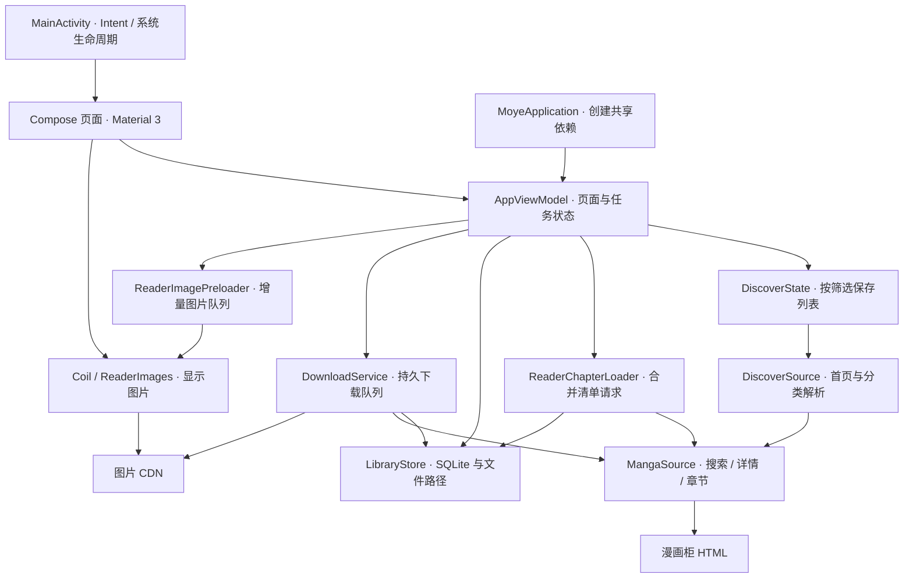

# 02 · 系统架构

[返回文档中心](README.md) · 基线：1.3.3

## 1. 真实架构形态

项目是单个 `:app` Gradle 模块、单 Activity、Compose 原生 UI。业务状态集中在 `AppViewModel`，发现页另有 `DiscoverState`；数据通过手工创建的 `MangaSource`、`LibraryStore` 和 Coil ImageLoader 访问。可以按表现、状态协调、数据访问和平台服务四个职责层理解，但代码没有拆成四个独立 Gradle 模块。

当前没有 Hilt/Koin、Room、Navigation Compose、WorkManager，也没有通用 Repository 接口。不要因为习惯使用 MVVM 术语，就假设这些抽象已存在。

## 2. 组件图

箭头表达调用／数据依赖，不代表每条边都是同步操作。可编辑的简化组件图见 [architecture.drawio](diagrams/architecture.drawio)。

## 3. 应用启动与依赖生命周期

1. `MoyeApplication.onCreate()` 创建 `LibraryStore`，调用 `recoverInterrupted()`，把上个进程遗留的 queued/downloading 任务转成 paused。
2. 创建 `MangaSource` 及其 OkHttpClient。
3. `MainActivity` 获得 Activity 范围的 `AppViewModel`，通过 `setContent` 建立 `MoyeApp`。
4. Coil 在需要时通过 `ImageLoaderFactory` 创建图片加载器。图片客户端基于 source.client 派生，增加 User-Agent、Referer 和图片域名候选逻辑。
5. ViewModel 初始化预加载偏好并订阅默认网络变化。订阅跟随 `viewModelScope`，结束时注销网络回调。MainActivity 在 onStart/onStop 通知可见性，不可见时取消阅读预取，重新可见时按当前页恢复；用户主动的下载服务独立运行。
6. Activity 首次创建处理 Intent；已有 savedInstanceState 时不重复处理启动链接。收到 onNewIntent 时单独解析新 Intent。

Application 与 SQLite helper 是进程级；ViewModel 是 Activity 作用域。旋转或尺寸变化通常保留 ViewModel，而进程死亡不能保留它的内存字段。

## 4. 四种核心数据流

### 4.1 发现和搜索

Compose 用户操作 → ViewModel / DiscoverState 更新 loading → 数据源在 IO 上请求与解析 → 主线程更新可观察状态 → Compose 重组。发现列表使用 BrowseKey 隔离筛选状态，不把不同分类结果写入同一个列表。

### 4.2 打开章节

read → 解析目标章 → 增加 readerGeneration → 取消旧阅读等待 → ReaderChapterLoader.get → 内存清单／本地完整清单／网络请求 → 恢复历史单页索引 → 发布 pages → 显示图片并按策略预加载。

只有当前 generation 可以回写 readerError 和 readerLoading。旧请求的收尾不能再关闭新请求的加载状态，这是 1.3.1 修复的关键约束。

### 4.3 离线下载

enqueue 写数据库 → 启动前台服务 → 串行挑选 queued 章节 → 获取清单 → 按图片逐个下载并校验 → 临时文件原子提交 → 更新 done/total/state → revision 通知 UI 刷新。

### 4.4 阅读历史

滚动／翻页确定单页索引 → recordPage 验证当前漫画和章节 → saveProgress 写 SQLite → revision 变化 → 详情与书架重新查询。预加载清单只写 manifests，不触碰 progress。

## 5. 线程与协程边界

| 工作 | 当前执行位置／机制 | 维护注意事项 |
| --- | --- | --- |
| Compose 状态写入 | 主线程，viewModelScope | 不从下载 IO 协程直接改 UI 字段 |
| 搜索、详情、发现 HTTP | withContext(IO) + execute | 取消协程不等于已主动取消底层阻塞 Call |
| 章节 HTTP | IO 外层 + OkHttp enqueue + 可取消 continuation | 取消时调用 Call.cancel；完成与失败都有代次隔离 |
| HTML / 清单解码 | 数据源 IO 工作内 | 不在 Composable 里解析大页面 |
| 图片显示／预取 | 单图片增量队列 + Coil 请求管线 | 预取仅缓存编码数据；显示时按视口档位解码 |
| 下载服务 | SupervisorJob + Dispatchers.IO | 手工队列、每页检查暂停状态 |
| SQLite 调用 | 同步方法，许多调用由主线程发起 | 尚未统一迁移到 IO repository，规模增大需注意耗时 |
| 数据库变更通知 | MutableStateFlow<Int> revision | 它是失效通知，不是数据库行级事件流 |

`@Synchronized` 使 store 的部分读写互斥，但并不把数据库操作自动变成异步。UI 中依赖 revision 的 remember 块会重新读库，数据量增大后应先测量再优化。

## 6. 生命周期与恢复层次

| 数据 | 切换标签／返回 | Activity 重建 | 进程重启 |
| --- | --- | --- | --- |
| 收藏、阅读进度、清单、下载状态 | 保留 | 保留 | SQLite 恢复 |
| 主题、方向、双页与预加载偏好 | 保留 | 保留 | SharedPreferences 恢复 |
| 发现结果／筛选、搜索结果 | 会话内保留 | ViewModel 保留 | 重新加载，不保证重建相同会话 |
| UI 滚动与弹层状态 | rememberSaveable / StateHolder 尽力恢复 | 支持的 saveable 状态恢复 | 不等同于完整业务会话恢复 |
| 工具栏显隐 | 同次阅读跨章保留 | ViewModel 保留 | 新会话默认显示 |
| 缩放比例／横移 | 当前阅读内容内保存 | 不承诺保留 | 不保存 |
| 下载中的连接 | 服务管理 | 不依赖阅读 Activity | 进程结束后任务转暂停，用户继续 |

## 7. 外部边界

源站负责目录、章节顺序、图片路径及其访问规则；App 负责解析、展示、缓存和本地进度。不存在服务端同步层，也没有源站稳定 API 的契约保证。GitHub 是源码与 APK 分发渠道，不参与 App 的阅读数据链路。

来源：[MoyeApplication.kt](../app/src/main/java/com/arnolee/moye/MoyeApplication.kt)、[MainActivity.kt](../app/src/main/java/com/arnolee/moye/MainActivity.kt)、[AppViewModel.kt](../app/src/main/java/com/arnolee/moye/AppViewModel.kt)、[DownloadService.kt](../app/src/main/java/com/arnolee/moye/DownloadService.kt)。
