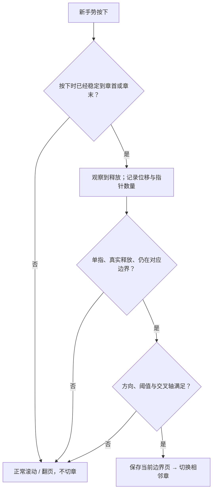

# 06 · 阅读器与手势实现

[返回文档中心](README.md) · 基线：1.3.4

## 1. 阅读器组成

ReaderScreen 处理“清单未就绪”的加载／错误页；ReaderContent 负责工具栏、目录、设置、进度、生命周期；ReaderViewport 选择横向或竖向布局；ComicImage 负责图片显示与横向阅读的局部缩放。

界面纵向分成顶栏、漫画视口、必要时出现的复位栏、底部页码与章节操作。漫画视口占剩余空间且 clipToBounds；复位栏单独占布局高度，不使用浮层覆盖漫画。隐藏工具栏后，非默认倍率的复位按钮仍可用。

工具栏显隐保存在 `AppViewModel.readerChrome`，不再放在按章节 key 重建的 ReaderContent 内。同一本漫画连续切章、按钮切章、末页额外滑动和 Activity 重建都保持现有显隐状态；隐藏状态加载下一章时也不临时显示返回框。退出阅读后重新进入或直接打开另一部漫画，默认显示工具栏。这个偏好是会话状态，不新增磁盘设置。底部原有的轻量页码／复位区域保持原布局，不覆盖漫画。

## 2. 规范页码与双页组

AppViewModel.readerPage 始终是原始图片索引，从 0 开始。单页直接映射；双页把封面独立为组 0，其后两张一组。

```text
原始图片索引： 0 | 1 2 | 3 4 | 5 6
显示组号：     0 |  1  |  2  |  3

dual group(page) = (page + 1) / 2  （整数除法）
dual first(group) = group == 0 ? 0 : group * 2 - 1
```

双页总组数为 `1 + total / 2`，最后一组可能只有一张，不创建虚拟空白页。日漫模式同时反转 pager 布局方向和组内页序。展开时原来索引 2 会落入组 1，不能在首次布局时错误覆盖为索引 1；因此 settledPage 监听先比较当前规范页所在组，只有组真正改变才保存组的第一张。

## 3. 图片请求与显示

ComicImage 通过 ReaderImages.request 优先选择已存在、长度非零的离线文件，否则构造远程 CDN URL。1.3.3 起按图片控件的实际像素宽度选择 640／960／1280／1600／1920／2400 档位，高度参数保持 4096。首次测量后立即选择；已有尺寸变化需要升级／调整档位时等待 180 ms，避免双指手势的每一帧都重新发起解码。纵向放大改变实际控件宽度，因此会在稳定后提升解码档位，最高仍为原来的 2400。横向局部缩放仍按原控件尺寸解码，与之前一致。

磁盘 key 与旧版一致，新增同身份的 memoryCacheKey 和 placeholderMemoryCacheKey，调整分辨率期间可复用原有位图作为占位。实际结果仍取决于原图尺寸、Coil 采样和内存缓存，不承诺每次输出都等于请求尺寸。已在预取中的可见图片先等待原请求完成，再从磁盘正常解码，避免同图同时下载。

初始竖向宽高比为 0.70，加载成功后从 drawable 宽高修正，允许最低 0.05 的长图比例。成功、加载中和失败分别影响 UI 状态。失败显示“第 N 页暂未加载”和单页重试；它与“清单请求失败”的整页错误是不同层次。

1.3.2 只对 layoutInfo 中可见的 pager 组／LazyColumn 条目创建显示用 AsyncImage；横向 beyondViewportPageCount 为 0。1.3.3 同时限制屏幕外加载占位动画；屏幕外未来图片由预加载策略决定，避免 Compose 预排条目绕过 Wi-Fi 或关闭设置。

## 4. 竖向缩放

### 4.1 实际布局变化

竖向 LazyColumn 的实际宽度为基础阅读列宽乘 scale，图片按宽高比同步变高或变矮，而不是仅把原来同样高度的位图绘制放大。这样放大之后仍可通过正常列表滚动看完整图片。

scale 被限制在 0.5–4.0。小于 1 时列在父容器中居中，横向偏移必须为 0；大于 1 时允许横向查看放大区域。基础阅读列宽上限 720 dp，最大缩放后实际内容可大于视口并被裁切。

横移边界：

```text
limit = max(width * (scale - 1) / 2, 0)
panX = clamp(requestedPanX, -limit, limit)
```

### 4.2 缩放锚点

为了尽量保持手指附近内容，按倍率变化调整列表偏移：

```text
newOffset = round((oldOffset + focusY) * newScale / oldScale - focusY)
```

缩放时保存当前 firstVisibleItemIndex，并取消上一个 anchorJob，启动新的 scrollToItem。横向偏移也围绕手指相对视口中心的位置换算，再限制边界。窗口宽度改变时重新约束 panX。

这是基于当前可见项与偏移的近似锚点策略，不是把整个滚动内容转成一个全局连续坐标。图片加载后高度变化、列表间距与边界限制都可能使视觉位置略有调整。

### 4.3 双击与恢复默认

默认倍率容差为 ±0.01。默认尺寸双击放大至 2.5；任何明显非默认尺寸双击恢复 1.0。复位按钮将倍率恢复 1、横移归零，并用当前首项锚点保存页码。缩小与放大都显示复位栏。

## 5. 手势分工

verticalZoomGestures 在 PointerEventPass.Initial 观察：

- 两指及以上：计算 centroid、zoom 和 pan，消费位置变化，执行缩放。
- 捏合后只剩一指：继续消费余下移动，避免松手变成列表 fling。
- 仅一指且放大：累计位移，超过 touchSlop 后区分横向／纵向；横向由缩放处理并消费，纵向留给 LazyColumn。
- 默认或缩小：竖向滚动交给列表，横向偏移不允许超出边界。

横向阅读每张图片使用 transformable，倍率范围仍为 1–4。只要任何图片倍率超过 1.01，pager 禁止翻页，避免拖动放大图片时误翻页；复位或图片销毁时解除 zoomed 状态。

## 6. 章首与章末双向滑动切章



触发阈值为 `max(64dp, touchSlop × 3)`；前进方向位移必须超过阈值，且大于交叉轴绝对位移的 1.5 倍。下一章方向为竖向上滑、LTR 左滑、RTL 右滑；上一章为竖向下滑、LTR 右滑、RTL 左滑。手势从按下时锁定 armed 状态，因此“本次滑到章首或最后一页”不会在同一次手势末尾直接跳章。

横向边界要求 settledPage 为最后组、没有滚动、没有放大；释放时仍为最后组。竖向边界要求最后图片底部进入视口，或已经滚到最后提示项，而且没有列表滚动／缩放锚点任务。不能只检查 firstVisibleItemIndex 是最后一页，否则长图未读完就可能跳走。

双指、交叉方向拖动、惯性滚动、没有 nextId 的最后章都不应切章。advanceFromEnd 再次检查当前漫画、章节与 loading 状态，先保存最后一张图片页码，然后用 adjacent 寻找目标。

上一章使用对称的独立 armed 状态：横向 settledPage 为组 0 且没有放大或滚动；纵向必须 `!list.canScrollBackward`，即第一张图片真正回到顶部，只有页码为 0 但图片已向下滚动不够。释放时再次检查边界；一页章可同时处于两端，按手势方向只执行一个分支。没有 prevId 时停留原章。

`retreatFromStart` 校验当前漫画、章节和 loading，保存本章第 0 页，再调用 read(startAtEnd=true) 打开上一章最后图片。纵向等待末图获得真实高度后恢复锚点，防止默认占位尺寸导致列表回填至倒数第二页；图片失败时也结束锚点恢复，保留重试入口。新章节加载和控件显隐仍沿用 1.3.3 逻辑。章节按钮／目录继续使用历史断点，不强制末页。

## 7. 历史与生命周期

snapshotFlow 监听列表首项或 pager 稳定组；页码滑块使用 jumpRequest，跳转完成后记录规范页。ReaderContent 监听 ON_PAUSE，并在移除时保存；read 切到新章后旧内容的保存被 recordPage 的 ID 检查隔离。

阅读器添加 FLAG_KEEP_SCREEN_ON，退出后清除。缩放倍率和页内像素偏移不写入数据库。阅读设置切换模式前先保存页码，新的布局从规范页码恢复。

## 8. 必测情形

1 页章、奇数／偶数页章、极长图片、首次打开与带历史打开；LTR/RTL；折叠展开后第二张页精确恢复；50% 与 400% 边界；工具栏隐藏后复位；最后图未完全看到时滑动；捏合末尾松开一指；无下一章；网络失败重试；暂停或返回时保存。

来源：[ReaderScreen.kt](../app/src/main/java/com/arnolee/moye/ReaderScreen.kt)、[ReaderZoom.kt](../app/src/main/java/com/arnolee/moye/ReaderZoom.kt)、[ChapterSwipe.kt](../app/src/main/java/com/arnolee/moye/ChapterSwipe.kt)、[AdaptiveLayout.kt](../app/src/main/java/com/arnolee/moye/AdaptiveLayout.kt)。
