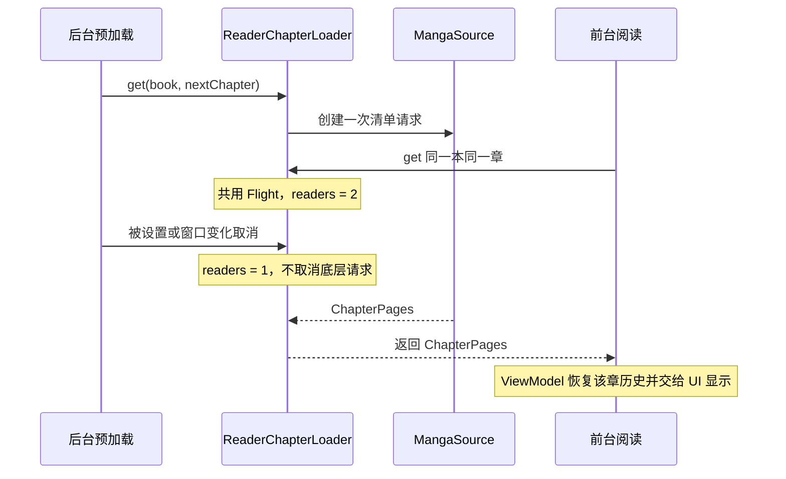

# 07 · 预加载、缓存与网络策略

[返回文档中心](README.md) · 基线：1.3.2

## 1. 四类缓存／存储必须区分

| 层次 | 数据 | 容量／有效期 | 生命周期 | 是否保证离线 |
| --- | --- | --- | --- | --- |
| ReaderChapterLoader.fresh | 已解码 ChapterPages | 最多 3 章，时间差 0–120,000 ms | 阅读会话内；退出清空 | 仅清单，不能保证图片 |
| SQLite manifests | ChapterPages JSON | 没有当前实现的总量／TTL 限制 | 持久 | 清单可回退，图片另判定 |
| Coil disk cache | 编码后的临时图片 | 150 × 1024 × 1024 字节 | 可淘汰，可手动清理 | 不承诺长期完整 |
| files/chapters | 下载服务提交的图片 | 没有自动总容量上限 | 用户删除或卸载 | 完整章用于离线 |

fresh 是按新结果插入顺序限制数量，命中时并不会自动提升顺序，因此不能准确称为 LRU。Coil 内存缓存采用库默认策略；项目没有单独声明一个内存缓存字节上限。

## 2. 预加载偏好

PreloadPreferences 包含 enabled、pages、wifiOnly，默认 true/5/true。读取和保存时把页数限制在 3–5。设置与阅读面板共用 PreloadControls，关闭主开关后页数与 Wi-Fi 控件禁用，但原值保留。

允许公式为 `enabled && (!wifiOnly || wifi)`。ViewModel 同时使用最近一次网络回调状态和即时 ReaderNetwork.isWifi 检查；设置变化或网络变化都会取消原预取并尝试为当前页建立新任务。

## 3. Wi-Fi 的判断与限制范围

ReaderNetwork 观察 ConnectivityManager 的默认网络，而不是只看 Wi-Fi 开关是否打开。默认网络必须具有 TRANSPORT_WIFI 与 NET_CAPABILITY_INTERNET；没有额外要求 NET_CAPABILITY_VALIDATED。因此“连接 Wi-Fi”并不证明外网或源站一定畅通。

VPN、热点、双网络等组合是否被允许，取决于系统报告的默认网络能力；无法识别为 Wi-Fi 时保守不预取。不是按 SSID、流量计费状态或特定机型判断，也不请求定位来读取 Wi-Fi 名称。

此设置只限制后台阅读预加载，不限制可见页面的正常联网、用户主动打开章节、封面浏览、搜索和显式下载。Wi-Fi 切换和底层网络变化不是一个原子操作，不能承诺切换瞬间已经发出的字节为零；实现会响应回调取消，并在每次预取前重新检查。

## 4. 窗口计算

窗口基于当前规范图片索引 index，而不是屏幕像素范围。先取当前章 index 之后最多 N 张；剩余名额才分给下一章。N 为 3、4 或 5。

| 当前章 17 页，0 基 index | N | 本章未来索引 | 下一章名额 |
| --- | --- | --- | --- |
| 0 | 5 | 1,2,3,4,5 | 0 |
| 14 | 5 | 15,16 | 3 |
| 16 | 5 | 无 | 5 |
| 14 | 3 | 15,16 | 1 |

下一章有历史时从历史页开始，未读过从 0 开始，并裁剪到下一章末尾。如果下一章太短，当前实现不会再递归进入第三章填满 N 张。双页模式和竖向一屏多页时，窗口仍按 readerPage 计算，部分“未来页”可能已经可见，所以它是请求上限规划，不是保证永远有 N 张完全未显示图片。

同一个漫画／章节／页码用 preloadKey 去重；页码变化时取消旧窗口。已有下载文件的页直接跳过；其他图片逐张使用 Coil.execute 预取，一次窗口只有一个主动预取图片任务。临近章末会并行启动下一章清单请求，避免等待本章所有图片预取结束后才请求目录数据。

## 5. 共享章节请求



每个 key 使用惰性 Deferred 和 Flight.readers。join 进入时加计数，离开时减计数；最后等待者离开且任务仍活跃，才移除并取消任务。任务完成回调只删除仍指向自己的 Flight，避免旧完成回调误删后来创建的新请求。

read 启动前台 get 后再释放 previousPreload。若顺序反过来，预取成为最后一个等待者时会把正在准备给前台的请求取消，导致本来能复用的请求被重新发送。

## 6. get 的选择顺序

1. 命中 2 分钟内 fresh：直接返回。
2. 同 key 有未取消的 Flight：加入等待。
3. 创建任务，读取 SQLite manifest。
4. 有清单且所有永久下载文件存在且非空：直接返回本地清单。
5. 否则请求源站，成功时持久保存新清单。
6. 非取消异常时，若已有旧清单则回退；没有旧清单则向前台返回错误。
7. 将结果加入 fresh，淘汰超出 3 章的最早插入项。

回退旧清单不是刷新过的签名保证；即使 manifest 存在，原图 URL 的访问参数也可能过期。fresh 的时间戳表示本地接收结果时间，不等于源站签名的真正有效期。

## 7. 图片缓存复用

ReaderImages 的磁盘键为：

```text
reader/{mangaId}/{chapterId}/{index}/{imagePath}
```

键不含 CDN 主机、临时签名 query 或解码尺寸，因此预取、切换候选主机和全尺寸显示能复用同一编码图片。预取设置 1×1 解码尺寸且禁用内存缓存，目的在于拿到磁盘中的原始编码数据，避免为每张未来图片保留大位图；不是把正式阅读图永久压缩为 1 像素。

本地下载文件始终优先。图片服务端在相同路径下替换内容时，该稳定键可能继续命中旧缓存；当前没有 ETag 驱动的主动版本更新，必要时使用设置里的缓存清理。

## 8. 取消、错误和数据副作用

- 预取失败静默结束或跳过，不把 readerError 设为失败，不弹出整页错误。
- 前台仍可重新 get 失败的章节，失败 Flight 不永久占住 key。
- 关闭预加载，或启用仅 Wi-Fi 时失去 Wi-Fi，会取消后台图片请求；没有其他等待者的清单请求也取消。
- 离开阅读调用 stopReader，清空 fresh 和 flights，并停止预取。
- 预取清单会写 manifests 和触发 revision；不会写 progress、favorite 或 downloads。
- 已经缓存的图片不会因为关掉开关被删除。

## 9. 资源与行为边界

预取不是完整章节下载、不是跨进程保活、不是无限前看，也不是“仅 Wi-Fi 下载”开关。普通图片客户端会尝试当前 hamreus 主机以及 eu1/eu2 候选；被取消后不继续候选循环。网络恢复不保证原错误图片立即全部自动刷新，当前页仍保留单页重试入口。

来源：[ReaderLoading.kt](../app/src/main/java/com/arnolee/moye/ReaderLoading.kt)、[ReaderImages.kt](../app/src/main/java/com/arnolee/moye/ReaderImages.kt)、[PreloadPreferences.kt](../app/src/main/java/com/arnolee/moye/PreloadPreferences.kt)、[AppViewModel.kt](../app/src/main/java/com/arnolee/moye/AppViewModel.kt)。
