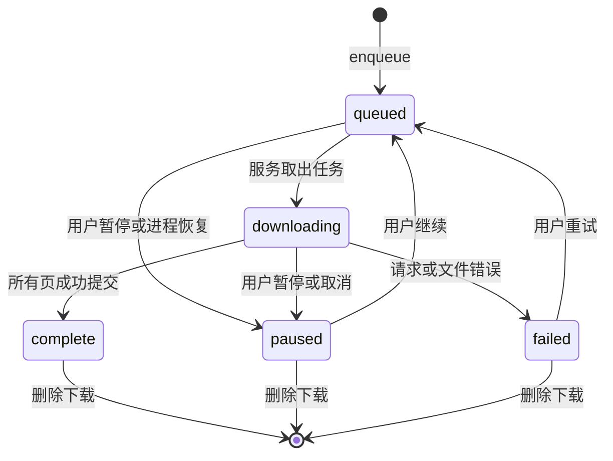

# 08 · 下载与离线阅读

[返回文档中心](README.md) · 基线：1.3.2

## 1. 用户入口与语义

下载可以从阅读器下载当前章、详情点击某章下载图标，或在批量模式选择部分／全选章节。任务是“章节”为单位，图片逐张提交。收藏与阅读历史不是下载前提，预加载策略也不限制用户主动发起的下载。

下载页展示全部任务／已下载、done/total、暂停／继续／离线阅读，以及带确认的删除。全部暂停只把 queued/downloading 任务改为 paused，没有全局自动定时恢复按钮。

## 2. 队列状态



这是任务生命周期的主要路径；删除也可作用于 queued/downloading，服务的状态检查和文件提交锁防止已删任务被重新写回。App 启动 recoverInterrupted 会将数据库残留的 queued/downloading 改为 paused，并写“上次下载已中断”。

enqueue 不重复加入已经 complete 或 downloading 的章节；其他任务重新置 queued，清空错误，已有图片仍可复用。任务按 created ASC、rowid ASC 取出，单 worker 串行处理章节，单章也逐页处理。

## 3. 前台服务

DownloadService 使用 SupervisorJob + Dispatchers.IO，启动时立即进入前台通知。通知渠道为 downloads，显示作品、章节与页数进度；点击通知通过 Intent 进入下载页。Android 10+ 声明 dataSync 类型，Manifest 包含前台服务及 dataSync 权限。

服务持有最多 6 小时的 PARTIAL_WAKE_LOCK，并在销毁时释放。Android 系统仍可限制、停止或终止服务，不能把这个锁解释成“保证后台下载永远不断”。服务返回 START_NOT_STICKY；当前没有 WorkManager、开机自动恢复或网络恢复自动恢复持久任务。

没有 queued 任务后退出前台并 stopSelfResult；若处理期间又有新任务入队，则继续处理。Android 的 onTimeout 回调会取消 worker 并停止服务。

## 4. 每章处理步骤

1. 用 onlyIf=queued 将任务转为 downloading。
2. 请求最新章节清单，不直接调用 ReaderChapterLoader 的会话缓存。
3. 检查任务仍可运行，并 putManifest。
4. 统计已有非空文件作为 done，设置 total。
5. 按图片索引循环；已有文件跳过，不重复下载已完成页。
6. 对当前缺失页依次尝试 eu、eu1、eu2，失败后等待 800 ms、1600 ms；取消异常立即向外传播。
7. 当前页保存成功后增加 done、更新数据库和通知，并等待 120 ms 再处理后页。
8. 最终检查 complete(p)，转为 complete。

读取清单和下载图各自有重试层。章节清单在 MangaSource 的瞬时错误下最多 3 次；图片循环最多 3 次候选请求。它们不是整个章节无限重试。

## 5. 图片原子保存

临时文件位于目标章节同目录，名称为 `page-*.part`。流程为：

```text
HTTP 响应成功
 → 检查已知长度不超过 60 MiB
 → 流式读取，每批检查任务状态与累计长度
 → out.fd.sync()
 → BitmapFactory 只解码尺寸，确认宽高有效
 → 在 store 锁内再次确认 state == downloading
 → renameTo 最终 .img 文件
```

已知 Content-Length 过大或读取累计超过 60 × 1024 × 1024 字节都会失败。扩展名统一 `.img`，实际格式保留源响应，可能是 WebP、JPEG、PNG；不是把内容转码成某一种固定格式。

commitPage 与 removeDownload 共用同步锁。若用户在图片下载中删除任务，最终状态检查拒绝提交；临时文件在 finally 清理。rename 保持在同目录／同文件系统内，以避免正式路径出现一半内容。

## 6. 暂停与继续

暂停是把数据库状态改成 paused。服务在每章、每页、读流循环及提交阶段调用 ensureRunning；状态变化触发取消。它不是为每个网络 Call 配置了统一的立即取消接口，阻塞 execute 或 read 可能要等网络返回／超时后才检查到暂停。

继续不是 HTTP Range 字节续传：完整页跳过，未完成的单张图片重新请求。保证单位是“完整图片文件”，不是某个图片下载到第几个字节。服务因异常失败时保留已成功的页，用户可重试。

## 7. 离线读取

read 通过清单检查永久文件齐全时不必请求网络；ReaderImages 对每页优先选择本地文件。断网可用还依赖本地书籍、清单和图片存在，而不只是 downloads.state 字符串写着 complete。

available/complete 当前只检查文件存在且长度非零。下载时已经做过图片解码校验，但每次进入阅读不会重新校验全部文件哈希或重新解码每页。用户外部篡改、磁盘损坏或文件被清理后的修复不属于当前自动保证范围。

## 8. 删除与存储管理

删除下载先删 downloads 记录，再递归删除该章目录。books、progress 和 manifests 保留，所以收藏及阅读位置不会丢失。设置“清理阅读图片缓存”只清 Coil 内存与磁盘缓存，不删除永久章节目录。

尚无磁盘配额、低空间预警、下载目录迁移或存储权限选择。bytesUsed 递归统计永久章节目录，UI 用 1024² 换算并显示 MB 标签。大量下载时，应同时观察磁盘空间和同步数据库操作的开销。

来源：[DownloadService.kt](../app/src/main/java/com/arnolee/moye/DownloadService.kt)、[LibraryStore.kt](../app/src/main/java/com/arnolee/moye/LibraryStore.kt)、[Screens.kt](../app/src/main/java/com/arnolee/moye/Screens.kt)。
