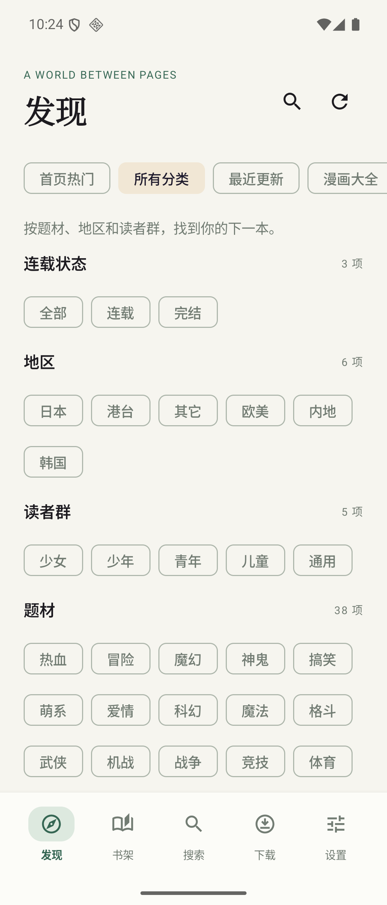
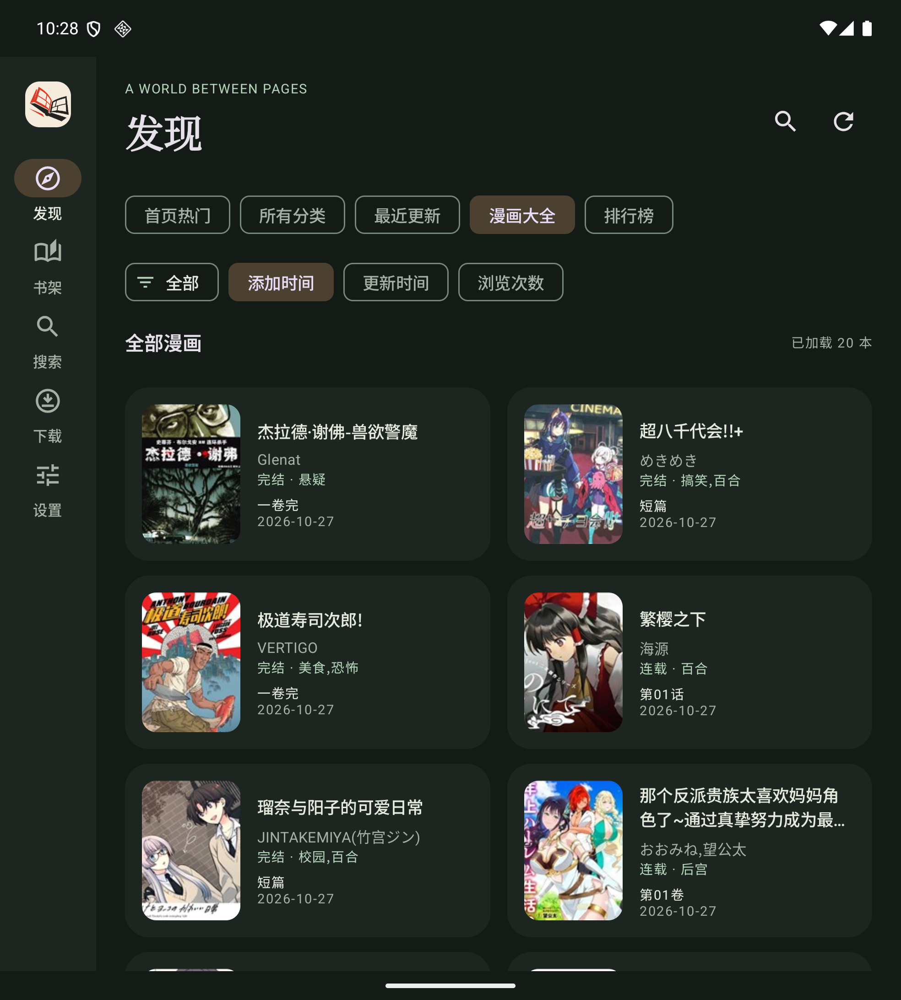

<div align="center">
  
  <h1>ComicReader</h1>
  <p>原生 Android 漫画阅读器 · 在线与离线阅读 · 为折叠屏适配</p>
  <p>Android 8.0+ · Kotlin · Jetpack Compose · Material 3</p>
</div>

ComicReader 将漫画柜移动站的搜索、分类与章节内容呈现在原生界面中，不加载网页广告或执行远程 JavaScript。米白与松绿的浅色主题、深墨夜间主题，让手机外屏与展开大屏都能舒适阅读。

**当前版本：1.3.4** · [下载与更新](https://github.com/hzxslzb/ComicReader/releases/latest) · [更新日志](CHANGELOG.md) · [1.3.4 发布公告](docs/releases/v1.3.4.md) · [测试记录](TESTING.md) · [完整技术文档](Doc/README.md)

## 下载与安装

在 [GitHub Releases](https://github.com/hzxslzb/ComicReader/releases) 下载 `ComicReader-1.3.4.apk`，传到 Android 手机并安装。`Source code` 是源码包，不能直接安装。Release 同时提供 SHA-256 校验文件。

**已安装旧版：直接覆盖安装，不要先卸载或清除数据。** 正式版本沿用包名 `com.arnolee.moye` 和同一签名，保留书架、阅读进度、设置与离线下载。1.3.3 沿用数据库版本 1 及原下载目录；已在模拟器验证正式签名 1.3.2 → 1.3.3 覆盖安装，10 个数据文件哈希一致，首次启动后书架、逐章进度、设置和下载均保留。

1.3.4 已进一步通过真实 GitHub 下载、系统授权与确认覆盖安装的端到端验证，原书库及离线图片保留，升级后断网续读正常。

自行签名的构建不能覆盖官方签名包。Debug 使用独立包名 `com.arnolee.moye.debug`，可以与正式版共存。卸载会删除本地数据；目前没有跨设备同步或导入导出。

## 界面预览

<p align="center">
  
  
</p>
<p align="center">
  
</p>

截图来自 Android 模拟器；作品封面及名称由数据源返回。

## 功能

| 功能 | 支持内容 |
| --- | --- |
| 全站搜索 | 关键词、分页、搜索历史、漫画柜链接打开，范围跟随站内搜索，并不限于某一部漫画 |
| 发现与分类 | 首页精选、热门连载、经典完结、漫迷推荐、最新上架、全部分类、最近更新、漫画大全、排行榜 |
| 筛选与排序 | 动态读取原站分类；漫画大全按添加时间、更新时间或浏览次数排序 |
| 书架与历史 | 收藏、最近阅读、继续阅读；每本漫画独立保存最近章节和页码 |
| 在线阅读 | 上下连续滚动、从左到右翻页、日漫从右到左翻页、页码跳转、目录与上下章 |
| 缩放 | 双指捏合、双击，连续滚动支持 0.5–4 倍；底部独立“恢复默认”按钮不遮挡漫画 |
| 预加载与网络恢复 | 可开关、选择后续 3／4／5 页及仅 Wi-Fi；窗口增量更新、仅缓存编码图片、后台自动暂停；章节短暂网络故障有限重试 |
| 双向滑动切章 | 章末再向下一页滑动进入下一章；章首再向上一页滑动返回上一章末页；保持工具栏显隐 |
| 应用更新 | 设置中检查 GitHub 正式版本、查看公告、下载安装；可关闭每日启动检查，不自动下载 |
| 本书阅读记录 | 详情页查看本书各章最近读到的页码和时间，点击恢复 |
| 下载与离线 | 单章、多选及整本队列，暂停、继续、失败重试、进度通知，完整下载后断网阅读 |
| 主题 | 浅色、深色、跟随系统；阅读时也可切换 |
| 折叠屏 | 自适应网格、侧边导航、详情分栏、宽屏双页，展开与收起保留准确页码 |

### 阅读手势

- 连续滚动：上下滑动阅读，双指缩放范围 50%–400%，缩小时居中，放大后可横向拖动；非默认尺寸双击可复位，默认尺寸双击放大；点“恢复默认”复位尺寸及横向位置。
- 普通翻页：向左为下一页；日漫模式向右为下一页。
- **章节末尾需要另一次主动滑动才切章**：纵向上滑、普通模式左滑、日漫模式右滑。到达末页的那次手势、惯性、双指缩放及放大横拖不会触发切章；最后一章停留原处。
- 主设置和阅读设置均提供预加载开关、3／4／5 页及“仅 Wi-Fi”选项，自动保存并立即生效。默认开启、5 页、仅 Wi-Fi；允许移动网络后会消耗流量。关闭或离开 Wi-Fi 会取消后台预取，但不限制当前页正常阅读。预加载使用临时缓存、不计入离线下载，也不修改下一章的阅读记录。
- 章首再向“上一页”方向滑动返回上一章末页：上下滚动向下拉、普通翻页向右滑、日漫模式向左滑。必须先停在真正的章首，滑回章首的那次动作不会连带切章；没有上一章时保持原处。
- 同一次阅读中切章保持工具栏显隐，隐藏状态加载下一章也不临时弹出控制框；退出阅读再进入时默认显示。
- 图片按实际显示宽度分档解码，纵向缩放稳定后再调整清晰度；预加载仅缓存编码图片，减少重复解码。
- 每部漫画、每章分别保存断点；下一章有历史则续读，没有历史从第一页开始。纵向位置精确到页码，不保存页内像素偏移或缩放倍率。

### 应用内更新

设置 → 应用更新 → 检查更新。发现新版后查看公告，点击“下载并安装”；完成后由系统确认覆盖安装。首次需要允许 ComicReader 安装应用，取消授权后可再次点击“安装更新”。默认启动时每天最多检查一次，可关闭；不会自动下载，不打断阅读弹窗。

仅接收本仓库正式 Release 的版本对应 APK；下载后及安装前校验 SHA-256、包名、签名和递增 versionCode。下载可取消；已完成的安装包可在应用重启后继续安装，未完成下载需重新下载。1.3.3 及更早版本没有此入口，先手动覆盖安装 1.3.4，后续更新即可在应用内完成。详见 [更新实现](Doc/16-应用更新与安装.md)。

### Galaxy Z Fold7

按当前窗口宽高适配，而非固定机型：窄屏底部导航，宽屏侧边导航；宽度达到 600 dp 时支持分栏和自动双页，低高度窗口会相应收紧布局。双页模式封面单独展示，日漫页序同步反转；连续滚动始终为单列，默认列宽上限 720 dp。

已在模拟器覆盖 Fold7 外屏 1080×2520、内屏 1968×2184 的比例，以及横屏、窄分屏和显示缩放。尚未进行实体 Fold7 验证；完整矩阵见 [TESTING.md](TESTING.md)。

## 数据源与本地数据

当前数据源为 [漫画柜移动站](https://m.manhuagui.com/)，不需要应用账号或自建服务器。应用不集成广告或分析 SDK，也不上传书架和阅读历史。

- 搜索及漫画可用范围由站点决定。分类为原站支持的单项筛选；不组合站点不支持的交叉条件。
- 最近更新与排行榜目前各提供 5 页、100 本；漫画大全按站点返回的总页数加载。分类数量等可能随站点变化。
- 发现、搜索与未下载章节需要联网；完成下载的章节使用本地文件。临时图片缓存与永久下载分离，删除下载不会删除收藏和阅读记录。
- 页面结构或图片地址规则变化时可能需要更新解析器；网络错误可重试，不自动绕过验证码或登录。章节自带的版权页、水印和宣传页按原图呈现。
- 仓库与安装包不附带漫画内容库；请尊重作品作者、版权方及数据源的使用规则。

## 从源码构建

需要 **JDK 17、Android SDK 35**，最低 Android 8.0（API 26）。项目自带 Gradle 8.9 Wrapper，首次构建需要网络下载依赖。

1. 克隆仓库（`git clone https://github.com/hzxslzb/ComicReader.git`），用 Android Studio 打开项目根目录，安装 SDK 35 并完成 Gradle 同步。
2. 命令行使用 `ANDROID_HOME`，或在未跟踪的 `local.properties` 中设置 `sdk.dir=/your/android/sdk`。
3. 在 macOS / Linux 运行：

```sh
./gradlew :app:assembleDebug
./gradlew :app:testDebugUnitTest :app:lintDebug
```

Debug APK 位于 `app/build/outputs/apk/debug/app-debug.apk`。

### 自行构建签名包

将 `signing.properties.example` 复制为 `signing.properties`，填写自己的 keystore 路径、别名与密码，然后运行：

```sh
./gradlew :app:assembleRelease
```

生成文件位于 `app/build/outputs/apk/release/`。官方签名私钥不在仓库中；使用自己的密钥时请安全备份，后续覆盖升级需保持相同包名及签名。不要提交真实签名配置或 keystore。

### 测试

```sh
./gradlew :app:testDebugUnitTest :app:lintDebug
# 仅在专用测试模拟器上运行设备测试
./gradlew :app:connectedDebugAndroidTest
```

设备测试会更改模拟器显示尺寸、网络开关和测试应用状态，部分流程依赖真实数据源。1.3.4 已通过 43 项 JVM 测试和本轮 9 项设备用例（双向切章、更新流程、章节请求与缩放回归）；Lint 为 0 errors、15 项既有 warnings。测试范围和限制见 [TESTING.md](TESTING.md)。

## 技术文档

完整文档统一放在顶层 [Doc/](Doc/README.md)，包含 16 篇专题，按当前 1.3.4 代码说明架构、用户功能和实现细节。

- 接手开发：[系统架构](Doc/02-系统架构.md)、[源码导航](Doc/03-源码导航与状态管理.md)、[数据模型](Doc/09-数据模型与持久化.md)。
- 阅读与下载：[阅读器手势](Doc/06-阅读器与手势实现.md)、[预加载与缓存](Doc/07-预加载缓存与网络策略.md)、[下载与离线](Doc/08-下载与离线阅读.md)。
- 维护发布：[构建与发布](Doc/12-开发构建与发布.md)、[测试与验收](Doc/13-测试体系与验收.md)、[故障排查](Doc/14-故障排查与维护手册.md)。

文档附有可编辑架构图和本地校验工具：`python3 Doc/tools/check_docs.py`。

## 项目结构

```text
app/src/main/          应用代码、Android 清单与资源
app/src/test/          JVM 测试与 HTML 解析样本
app/src/androidTest/   阅读、下载、缩放、折叠与数据库设备测试
assets/branding/      图标原稿与生成说明
Doc/                  完整技术文档、可编辑架构图与文档校验工具
docs/                 历史实现概览、截图与发布公告
gradle/               Gradle Wrapper
```

主要实现：Kotlin + Jetpack Compose + Material 3；OkHttp 请求、Jsoup 解析、Coil 图片加载；SQLite 保存收藏、章节进度和下载任务，SharedPreferences 保存偏好。详细说明见 [技术文档中心](Doc/README.md)；原有 [实现概览](docs/IMPLEMENTATION.md) 保留作为简版入口。

## 反馈与致谢

提交 Issue 时请提供 App 版本、Android 版本、设备型号、阅读模式、复现步骤，以及有问题的公开漫画或章节链接；不要上传个人数据库、签名文件或账号凭据。

功能设计参考 [Ehviewer_CN_SXJ](https://github.com/xiaojieonly/Ehviewer_CN_SXJ) 的阅读与下载体验。ComicReader 的数据源解析、界面和存储在本项目中实现；漫画内容归相应权利人所有。图标采用构成主义几何风格，原稿及生成说明位于 [assets/branding](assets/branding)。
